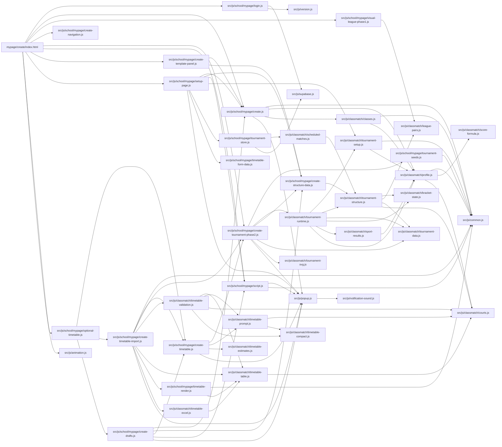

# ClassMatch ソース構造

このファイルは `npm run inspect:structure` で全ファイル一覧と依存関係から生成します。
JSはAST、HTMLはHTMLパーサー、CSSはCSSパーサーで点検しています。画像・音声はファイル一覧に含めます。
`node_modules`、`dist`、Git内部、環境変数ファイルは対象外です。静的な依存関係の点検であり、全画面の実行・DB権限・コード品質を保証するレビューではありません。

対象: 262ファイル / JS 95 / HTML 19 / CSS 38 / ビルド入口 17。

## 追い方

1. 変更したい画面のHTMLから、読み込まれるJSを確認します。
2. JSのimportをたどり、画面のDOM操作・計算処理・DB通信を分けて読みます。
3. importに現れない連携はJSONの `events`、`selectors`、`storage`、`tables` で確認します。
4. Figmaには画面単位の3〜5箱だけを置き、詳細はこの自動生成資料にリンクします。

## 画面の入口

| HTML | 直接読み込むJS | 関連JS数 |
| --- | --- | ---: |
| [index.html](../index.html) | [src/js/school/account.js](../src/js/school/account.js) [src/js/school/login.js](../src/js/school/login.js) [src/js/load.js](../src/js/load.js) [src/js/animation.js](../src/js/animation.js) | 8 |
| [login/index.html](../login/index.html) | [src/js/school/login.js](../src/js/school/login.js) [src/js/animation.js](../src/js/animation.js) | 5 |
| [login/account.html](../login/account.html) | [src/js/animation.js](../src/js/animation.js) [src/js/school/mypage/login.js](../src/js/school/mypage/login.js) [src/js/school/google.js](../src/js/school/google.js) | 7 |
| [mypage/index.html](../mypage/index.html) | [src/js/school/mypage/login.js](../src/js/school/mypage/login.js) [src/js/school/mypage/system.js](../src/js/school/mypage/system.js) [src/js/load.js](../src/js/load.js) [src/js/animation.js](../src/js/animation.js) | 6 |
| [mypage/account/index.html](../mypage/account/index.html) | [src/js/school/mypage/login.js](../src/js/school/mypage/login.js) [src/js/school/mypage/account.js](../src/js/school/mypage/account.js) | 8 |
| [mypage/account/passwordreset.html](../mypage/account/passwordreset.html) | [src/js/school/mypage/reset.js](../src/js/school/mypage/reset.js) | 6 |
| [mypage/class-profile/index.html](../mypage/class-profile/index.html) | [src/js/school/mypage/login.js](../src/js/school/mypage/login.js) [src/js/school/mypage/class-profile.js](../src/js/school/mypage/class-profile.js) | 11 |
| [mypage/create/index.html](../mypage/create/index.html) | [src/js/school/mypage/login.js](../src/js/school/mypage/login.js) [src/js/school/mypage/create.js](../src/js/school/mypage/create.js) [src/js/school/mypage/visual-league-phase1.js](../src/js/school/mypage/visual-league-phase1.js) [src/js/school/mypage/create-navigation.js](../src/js/school/mypage/create-navigation.js) [src/js/school/mypage/create-tournament-phase2.js](../src/js/school/mypage/create-tournament-phase2.js) [src/js/school/mypage/script.js](../src/js/school/mypage/script.js) [src/js/school/mypage/create-template-panel.js](../src/js/school/mypage/create-template-panel.js) [src/js/school/mypage/setup-page.js](../src/js/school/mypage/setup-page.js) [src/js/school/mypage/optional-timetable.js](../src/js/school/mypage/optional-timetable.js) [src/js/animation.js](../src/js/animation.js) | 42 |
| [mypage/edit/index.html](../mypage/edit/index.html) | [src/js/school/mypage/login.js](../src/js/school/mypage/login.js) [src/js/school/mypage/edit.js](../src/js/school/mypage/edit.js) [src/js/school/mypage/edit-navigation.js](../src/js/school/mypage/edit-navigation.js) [src/js/school/mypage/bracket-operations.js](../src/js/school/mypage/bracket-operations.js) [src/js/school/mypage/tournament-settings.js](../src/js/school/mypage/tournament-settings.js) [src/js/load.js](../src/js/load.js) [src/js/animation.js](../src/js/animation.js) | 29 |
| [mypage/edit/basic/index.html](../mypage/edit/basic/index.html) | [src/js/school/mypage/login.js](../src/js/school/mypage/login.js) [src/js/school/mypage/create.js](../src/js/school/mypage/create.js) [src/js/school/mypage/visual-league-phase1.js](../src/js/school/mypage/visual-league-phase1.js) [src/js/school/mypage/create-navigation.js](../src/js/school/mypage/create-navigation.js) [src/js/school/mypage/create-tournament-phase2.js](../src/js/school/mypage/create-tournament-phase2.js) [src/js/school/mypage/script.js](../src/js/school/mypage/script.js) [src/js/school/mypage/create-template-panel.js](../src/js/school/mypage/create-template-panel.js) [src/js/school/mypage/setup-page.js](../src/js/school/mypage/setup-page.js) [src/js/school/mypage/optional-timetable.js](../src/js/school/mypage/optional-timetable.js) [src/js/school/mypage/edit-navigation.js](../src/js/school/mypage/edit-navigation.js) [src/js/animation.js](../src/js/animation.js) | 43 |
| [mypage/edit/documents/index.html](../mypage/edit/documents/index.html) | [src/js/school/mypage/login.js](../src/js/school/mypage/login.js) [src/js/school/mypage/create.js](../src/js/school/mypage/create.js) [src/js/school/mypage/visual-league-phase1.js](../src/js/school/mypage/visual-league-phase1.js) [src/js/school/mypage/create-navigation.js](../src/js/school/mypage/create-navigation.js) [src/js/school/mypage/create-tournament-phase2.js](../src/js/school/mypage/create-tournament-phase2.js) [src/js/school/mypage/script.js](../src/js/school/mypage/script.js) [src/js/school/mypage/create-template-panel.js](../src/js/school/mypage/create-template-panel.js) [src/js/school/mypage/setup-page.js](../src/js/school/mypage/setup-page.js) [src/js/school/mypage/optional-timetable.js](../src/js/school/mypage/optional-timetable.js) [src/js/school/mypage/edit-navigation.js](../src/js/school/mypage/edit-navigation.js) [src/js/school/mypage/documents-page.js](../src/js/school/mypage/documents-page.js) [src/js/animation.js](../src/js/animation.js) | 45 |
| [mypage/score-profile/index.html](../mypage/score-profile/index.html) | [src/js/school/mypage/login.js](../src/js/school/mypage/login.js) [src/js/school/mypage/score-profile.js](../src/js/school/mypage/score-profile.js) [src/js/animation.js](../src/js/animation.js) | 13 |
| [system/index.html](../system/index.html) | [src/js/system/load.js](../src/js/system/load.js) [src/js/system/login.js](../src/js/system/login.js) [src/js/animation.js](../src/js/animation.js) | 8 |
| [system/announcements/index.html](../system/announcements/index.html) | [src/js/system/session.js](../src/js/system/session.js) [src/js/system/message.js](../src/js/system/message.js) [src/js/system/announce/result.js](../src/js/system/announce/result.js) [src/js/animation.js](../src/js/animation.js) | 10 |
| [system/core/index.html](../system/core/index.html) | [src/js/system/session.js](../src/js/system/session.js) [src/js/system/message.js](../src/js/system/message.js) [src/js/system/core/result.js](../src/js/system/core/result.js) [src/js/animation.js](../src/js/animation.js) | 23 |
| [system/manage/index.html](../system/manage/index.html) | [src/js/system/session.js](../src/js/system/session.js) [src/js/system/message.js](../src/js/system/message.js) [src/js/system/manage/sendresult.js](../src/js/system/manage/sendresult.js) [src/js/animation.js](../src/js/animation.js) | 21 |
| [system/result/index.html](../system/result/index.html) | [system/result/script.js](../system/result/script.js) | 8 |

## 作成画面の依存図

矢印は読み込み方向です。イベント発火や処理順を表す図ではありません。

## JS一覧

| ファイル | 行数 | export | DBテーブル | イベント |
| --- | ---: | --- | --- | --- |
| [scripts/audit-source.mjs](../scripts/audit-source.mjs) | 27 |  |  |  |
| [scripts/inspect-structure.mjs](../scripts/inspect-structure.mjs) | 215 |  |  |  |
| [src/js/animation.js](../src/js/animation.js) | 65 |  |  | listen: DOMContentLoaded, listen: mousemove, listen: mouseleave |
| [src/js/classmatch/bracket-state.js](../src/js/classmatch/bracket-state.js) | 38 | arrangeEntrants, resolveBracket, matchType |  |  |
| [src/js/classmatch/class-totals.js](../src/js/classmatch/class-totals.js) | 32 | aggregateClassTotals |  |  |
| [src/js/classmatch/classes.js](../src/js/classmatch/classes.js) | 53 | cloneClassJson, DEFAULT_CLASS_PROFILE, normalizeClassRow, normalizeClassProfile, validateClassProfile, downloadJson, readJsonFile |  |  |
| [src/js/classmatch/courts.js](../src/js/classmatch/courts.js) | 11 | getSportCourts, courtKey |  |  |
| [src/js/classmatch/document-diagrams.js](../src/js/classmatch/document-diagrams.js) | 68 | leagueDiagram, bracketDiagram |  |  |
| [src/js/classmatch/league-pairs.js](../src/js/classmatch/league-pairs.js) | 16 | generateVisualLeaguePairs, visualLeaguePoints |  |  |
| [src/js/classmatch/local-scores.js](../src/js/classmatch/local-scores.js) | 20 | cacheScoreSnapshot, localScores |  |  |
| [src/js/classmatch/profile.js](../src/js/classmatch/profile.js) | 325 | cloneJson, evaluateScoreFormula, SPORT_FORMATS, RANKING_RULES, DEFAULT_PROFILE, CURRENT_SCORE_FORMULA, normalizeSport, normalizeProfile, validateProfile, tournamentConfigFromProfile, profileFromTournamentConfig, calculateOverallPoints, FORMULA_VARIABLES, downloadJson, readJsonFile |  |  |
| [src/js/classmatch/result-reference.js](../src/js/classmatch/result-reference.js) | 28 | attachBracketReference |  |  |
| [src/js/classmatch/scheduled-matches.js](../src/js/classmatch/scheduled-matches.js) | 13 | plannedMatches |  |  |
| [src/js/classmatch/score-formula.js](../src/js/classmatch/score-formula.js) | 98 | FORMULA_ALIASES, parseScoreFormula, evaluateScoreFormula |  |  |
| [src/js/classmatch/sport-results.js](../src/js/classmatch/sport-results.js) | 287 | isTournamentMatch, buildStats, compareLeague, buildSportResultsPayload |  |  |
| [src/js/classmatch/timetable-compact.js](../src/js/classmatch/timetable-compact.js) | 116 | createTimetableAliases, compactTimetableInput, expandTimetableOutputIds |  |  |
| [src/js/classmatch/timetable-estimates.js](../src/js/classmatch/timetable-estimates.js) | 43 | availableMinutes, sportTimeEstimate, durationLabel |  |  |
| [src/js/classmatch/timetable-excel.js](../src/js/classmatch/timetable-excel.js) | 61 | timetableWorkbookXML |  |  |
| [src/js/classmatch/timetable-prompt.js](../src/js/classmatch/timetable-prompt.js) | 60 | TIMETABLE_RULES, validateTimetableSettings, generateTimetablePrompt |  |  |
| [src/js/classmatch/timetable-table.js](../src/js/classmatch/timetable-table.js) | 166 | timetableMinute, timetableTime, createTimetableAxis, timeToY, yToTime, timetableMovePatch, timetableTeamName, eventAppliesToCourt, resolveFlexibleEvents, buildTimetableAxisPages, sportTimeTicks, paginateTimetable, buildTimetablePages, timetablePagesTSV, timetableSportSheets |  |  |
| [src/js/classmatch/timetable-validation.js](../src/js/classmatch/timetable-validation.js) | 144 | validateTimetableJSON |  |  |
| [src/js/classmatch/tournament-data.js](../src/js/classmatch/tournament-data.js) | 109 | generateTournamentData |  |  |
| [src/js/classmatch/tournament-runtime.js](../src/js/classmatch/tournament-runtime.js) | 64 | tournamentRuntime |  |  |
| [src/js/classmatch/tournament-setup.js](../src/js/classmatch/tournament-setup.js) | 66 | validateSetup, restoreSetup |  |  |
| [src/js/classmatch/tournament-structure.js](../src/js/classmatch/tournament-structure.js) | 211 | generateTournamentStructure, validateTournamentStructure |  |  |
| [src/js/classmatch/tournament-svg.js](../src/js/classmatch/tournament-svg.js) | 36 | measureTeamStartPoints, drawLine, renderTournamentSVG |  |  |
| [src/js/common.js](../src/js/common.js) | 61 | escapeHtml, node, compactName, csvEscape, downloadText, normalizeTeamName, compareTuple, plainObject, safeString, safeNumber, clearBranchSession, safeText, setBusy, routeForBranch, cloneJson |  |  |
| [src/js/load.js](../src/js/load.js) | 12 |  |  | listen: load |
| [src/js/notification-sound.js](../src/js/notification-sound.js) | 25 | playNotificationSound |  |  |
| [src/js/notification-state.js](../src/js/notification-state.js) | 28 | isOwnAnnouncement, oldestAnnouncementsFirst, completedResultIds, hasNewResults, newestCompletedResultAt, hasResultNewerThan |  |  |
| [src/js/password-policy.js](../src/js/password-policy.js) | 5 | PASSWORD_MESSAGE, validPassword |  |  |
| [src/js/popup.js](../src/js/popup.js) | 26 | popup |  |  |
| [src/js/school/account.js](../src/js/school/account.js) | 83 |  | schools | listen: click |
| [src/js/school/google.js](../src/js/school/google.js) | 92 |  | schools | listen: DOMContentLoaded, listen: click |
| [src/js/school/login.js](../src/js/school/login.js) | 52 |  |  | listen: DOMContentLoaded, listen: keypress, listen: click |
| [src/js/school/mypage/account.js](../src/js/school/mypage/account.js) | 230 |  | schools | listen: DOMContentLoaded, listen: click |
| [src/js/school/mypage/bracket-operations.js](../src/js/school/mypage/bracket-operations.js) | 79 |  |  | emit: classmatch:sports-config-updated, emit: classmatch:matches-updated, listen: classmatch:matches-updated |
| [src/js/school/mypage/class-profile.js](../src/js/school/mypage/class-profile.js) | 117 | collect |  | listen: click, listen: change |
| [src/js/school/mypage/create-drafts.js](../src/js/school/mypage/create-drafts.js) | 99 |  |  | listen: click, listen: change |
| [src/js/school/mypage/create-navigation.js](../src/js/school/mypage/create-navigation.js) | 62 |  |  | listen: change, listen: click, listen: keydown |
| [src/js/school/mypage/create-structure-data.js](../src/js/school/mypage/create-structure-data.js) | 62 | collectTournamentInput, generateCurrentTournamentStructure, downloadTournamentJSON |  |  |
| [src/js/school/mypage/create-template-panel.js](../src/js/school/mypage/create-template-panel.js) | 45 |  |  | listen: load, listen: click |
| [src/js/school/mypage/create-timetable-import.js](../src/js/school/mypage/create-timetable-import.js) | 157 |  |  | listen: click, listen: change, listen: input |
| [src/js/school/mypage/create-timetable.js](../src/js/school/mypage/create-timetable.js) | 234 | restoreTimetableSettings, collectTimetableSettings |  | listen: click, listen: change, listen: input, listen: classmatch:tournament-structure-updated, listen: classmatch:restore-timetable |
| [src/js/school/mypage/create-tournament-phase2.js](../src/js/school/mypage/create-tournament-phase2.js) | 276 | generateCurrentTournamentJSON |  | listen: classmatch:setup-loaded, listen: change, emit: classmatch:tournament-structure-updated, listen: input, listen: click, listen: classmatch:restore-extra-entrants |
| [src/js/school/mypage/create.js](../src/js/school/mypage/create.js) | 316 | applyClassProfile, collectClasses, restoreClasses, restoreTournamentInput, applyProfile |  | emit: classmatch:restore-extra-entrants, listen: change, listen: click, listen: input |
| [src/js/school/mypage/documents-page.js](../src/js/school/mypage/documents-page.js) | 24 |  |  | listen: afterprint, listen: click, listen: classmatch:setup-loaded |
| [src/js/school/mypage/edit-forms.js](../src/js/school/mypage/edit-forms.js) | 236 | editForms |  |  |
| [src/js/school/mypage/edit-navigation.js](../src/js/school/mypage/edit-navigation.js) | 8 |  |  |  |
| [src/js/school/mypage/edit.js](../src/js/school/mypage/edit.js) | 298 |  | semesters, semesters_branch, tournament_classes, matches, leagues, announcements, matches_report, leagues_teams | listen: submit, emit: classmatch:sports-config-updated, listen: click, listen: classmatch:matches-updated |
| [src/js/school/mypage/formula-editor.js](../src/js/school/mypage/formula-editor.js) | 39 | openFormulaEditor |  | listen: click, listen: input, listen: close |
| [src/js/school/mypage/login.js](../src/js/school/mypage/login.js) | 95 |  | schools, semesters | listen: DOMContentLoaded, listen: click |
| [src/js/school/mypage/optional-timetable.js](../src/js/school/mypage/optional-timetable.js) | 6 |  |  | emit: classmatch:restore-timetable |
| [src/js/school/mypage/reconcile-results.js](../src/js/school/mypage/reconcile-results.js) | 13 | reconcileTournamentResults |  | emit: classmatch:matches-updated, emit: classmatch:sports-config-updated |
| [src/js/school/mypage/reset.js](../src/js/school/mypage/reset.js) | 49 |  |  | listen: DOMContentLoaded, listen: click |
| [src/js/school/mypage/score-profile-view.js](../src/js/school/mypage/score-profile-view.js) | 135 | courtRow, sportCard |  |  |
| [src/js/school/mypage/score-profile.js](../src/js/school/mypage/score-profile.js) | 241 | collect |  | listen: click, listen: input, listen: change |
| [src/js/school/mypage/script.js](../src/js/school/mypage/script.js) | 36 | appendBranch |  | listen: click, listen: input |
| [src/js/school/mypage/setup-page.js](../src/js/school/mypage/setup-page.js) | 118 | collectSetup |  | listen: click, emit: classmatch:restore-timetable, emit: classmatch:setup-loaded, listen: input, listen: change |
| [src/js/school/mypage/system.js](../src/js/school/mypage/system.js) | 6 |  |  | listen: click |
| [src/js/school/mypage/timetable-form-data.js](../src/js/school/mypage/timetable-form-data.js) | 22 | collectTimetableForm |  |  |
| [src/js/school/mypage/timetable-render.js](../src/js/school/mypage/timetable-render.js) | 93 | renderAxisPage |  |  |
| [src/js/school/mypage/tournament-seeds.js](../src/js/school/mypage/tournament-seeds.js) | 19 | renderSeedControls |  |  |
| [src/js/school/mypage/tournament-settings.js](../src/js/school/mypage/tournament-settings.js) | 365 |  | semesters, leagues, matches, sport_results, tournament_classes, leagues_teams | listen: click, listen: change, listen: input, listen: submit, listen: classmatch:sports-config-updated |
| [src/js/school/mypage/tournament-store.js](../src/js/school/mypage/tournament-store.js) | 70 | loadTournament, saveSetup, saveConfig | semesters, tournament_classes, leagues, semesters_branch, matches, leagues_teams |  |
| [src/js/school/mypage/visual-league-phase1.js](../src/js/school/mypage/visual-league-phase1.js) | 121 |  |  | listen: change |
| [src/js/supabase.js](../src/js/supabase.js) | 151 | publicSupabase, supabase, sortNewestFirst, sortMatchesNewestFirst, worker, broadcastAnnouncementsSB, coreScoreDataSB, upsertCoreSportResultsSB, branchesSB, semesterNameSB | semesters_branch, semesters |  |
| [src/js/system/announce/result.js](../src/js/system/announce/result.js) | 145 |  | leagues_teams, matches | listen: change |
| [src/js/system/core/result.js](../src/js/system/core/result.js) | 353 |  | leagues_teams, leagues, matches, matches_report | listen: submit, listen: click, listen: change |
| [src/js/system/core/score-view.js](../src/js/system/core/score-view.js) | 120 | renderCoreScores |  |  |
| [src/js/system/load.js](../src/js/system/load.js) | 57 |  | public_semesters_view, public_semesters_branch_view | listen: DOMContentLoaded |
| [src/js/system/login.js](../src/js/system/login.js) | 68 |  |  | listen: click |
| [src/js/system/manage/sendresult.js](../src/js/system/manage/sendresult.js) | 273 |  | tournament_classes, leagues_teams, matches, leagues | listen: DOMContentLoaded, listen: change, listen: click |
| [src/js/system/message.js](../src/js/system/message.js) | 228 |  | announcements, semesters_branch | listen: DOMContentLoaded, listen: click |
| [src/js/system/result/report.js](../src/js/system/result/report.js) | 1 |  |  |  |
| [src/js/system/result/script.js](../src/js/system/result/script.js) | 227 |  | leagues_teams, matches | listen: resize, listen: change, listen: click |
| [src/js/system/session.js](../src/js/system/session.js) | 38 |  |  | listen: DOMContentLoaded, listen: click |
| [src/js/version.js](../src/js/version.js) | 2 | version |  |  |
| [system/result/script.js](../system/result/script.js) | 2 |  |  |  |
| [tests/create-tournament.browser.mjs](../tests/create-tournament.browser.mjs) | 279 |  |  |  |
| [tests/notifications.browser.mjs](../tests/notifications.browser.mjs) | 99 |  |  |  |
| [tests/notifications.test.mjs](../tests/notifications.test.mjs) | 34 |  |  |  |
| [tests/timetable-estimates.test.mjs](../tests/timetable-estimates.test.mjs) | 26 |  |  |  |
| [tests/timetable-fixture.mjs](../tests/timetable-fixture.mjs) | 13 | fixture |  |  |
| [tests/timetable-layout.browser.mjs](../tests/timetable-layout.browser.mjs) | 94 |  |  |  |
| [tests/timetable-prompt.test.mjs](../tests/timetable-prompt.test.mjs) | 85 |  |  |  |
| [tests/timetable-table.test.mjs](../tests/timetable-table.test.mjs) | 70 |  |  |  |
| [tests/timetable-validation.test.mjs](../tests/timetable-validation.test.mjs) | 108 |  |  |  |
| [tests/tournament-data.test.mjs](../tests/tournament-data.test.mjs) | 142 |  |  |  |
| [tests/tournament-followup.test.mjs](../tests/tournament-followup.test.mjs) | 55 |  |  |  |
| [tests/tournament-persistence.test.mjs](../tests/tournament-persistence.test.mjs) | 85 |  |  |  |
| [tests/tournament-upgrade.browser.mjs](../tests/tournament-upgrade.browser.mjs) | 202 |  |  |  |
| [tests/tournament-upgrade.test.mjs](../tests/tournament-upgrade.test.mjs) | 113 |  |  |  |
| [tests/venue-profile.test.mjs](../tests/venue-profile.test.mjs) | 26 |  |  |  |
| [vite.config.js](../vite.config.js) | 40 | default |  |  |

## CSS一覧

| ファイル | 行数 | 読み込み元 |
| --- | ---: | --- |
| [login/style.css](../login/style.css) | 4 | [login/account.html](../login/account.html) [login/index.html](../login/index.html) |
| [mypage/style.css](../mypage/style.css) | 9 | [mypage/account/index.html](../mypage/account/index.html) [mypage/account/passwordreset.html](../mypage/account/passwordreset.html) [mypage/class-profile/index.html](../mypage/class-profile/index.html) [mypage/create/index.html](../mypage/create/index.html) [mypage/edit/basic/index.html](../mypage/edit/basic/index.html) [mypage/edit/documents/index.html](../mypage/edit/documents/index.html) [mypage/edit/index.html](../mypage/edit/index.html) [mypage/index.html](../mypage/index.html) [mypage/score-profile/index.html](../mypage/score-profile/index.html) |
| [src/css/announcements/style.css](../src/css/announcements/style.css) | 164 | [system/announcements/style.css](../system/announcements/style.css) |
| [src/css/box.css](../src/css/box.css) | 6 |  |
| [src/css/common.css](../src/css/common.css) | 634 | [login/style.css](../login/style.css) [mypage/style.css](../mypage/style.css) [style.css](../style.css) [system/announcements/style.css](../system/announcements/style.css) [system/core/style.css](../system/core/style.css) [system/manage/style.css](../system/manage/style.css) [system/result/style.css](../system/result/style.css) [system/style.css](../system/style.css) |
| [src/css/first/create.css](../src/css/first/create.css) | 170 |  |
| [src/css/first/open.css](../src/css/first/open.css) | 101 |  |
| [src/css/home/animation.css](../src/css/home/animation.css) | 113 | [login/style.css](../login/style.css) [mypage/style.css](../mypage/style.css) [style.css](../style.css) |
| [src/css/home/quit.css](../src/css/home/quit.css) | 34 | [mypage/style.css](../mypage/style.css) [style.css](../style.css) |
| [src/css/home/scroll.css](../src/css/home/scroll.css) | 28 | [style.css](../style.css) |
| [src/css/home/style.css](../src/css/home/style.css) | 464 | [style.css](../style.css) |
| [src/css/login/account.css](../src/css/login/account.css) | 5 | [login/style.css](../login/style.css) |
| [src/css/login/style.css](../src/css/login/style.css) | 201 | [login/style.css](../login/style.css) |
| [src/css/manage/login-out.css](../src/css/manage/login-out.css) | 121 | [system/announcements/style.css](../system/announcements/style.css) [system/core/style.css](../system/core/style.css) [system/manage/style.css](../system/manage/style.css) |
| [src/css/manage/stylev1.0.3.css](../src/css/manage/stylev1.0.3.css) | 697 | [system/announcements/style.css](../system/announcements/style.css) [system/core/style.css](../system/core/style.css) [system/manage/style.css](../system/manage/style.css) |
| [src/css/mypage/account.css](../src/css/mypage/account.css) | 131 | [mypage/style.css](../mypage/style.css) [style.css](../style.css) |
| [src/css/mypage/create-visual.css](../src/css/mypage/create-visual.css) | 154 | [mypage/create/index.html](../mypage/create/index.html) [mypage/edit/basic/index.html](../mypage/edit/basic/index.html) [mypage/edit/documents/index.html](../mypage/edit/documents/index.html) |
| [src/css/mypage/exist.css](../src/css/mypage/exist.css) | 376 | [mypage/style.css](../mypage/style.css) |
| [src/css/mypage/formula-editor.css](../src/css/mypage/formula-editor.css) | 11 | [src/css/mypage/tournament-editor.css](../src/css/mypage/tournament-editor.css) |
| [src/css/mypage/mypage.css](../src/css/mypage/mypage.css) | 124 | [mypage/style.css](../mypage/style.css) |
| [src/css/mypage/page-responsive.css](../src/css/mypage/page-responsive.css) | 64 | [src/css/login/account.css](../src/css/login/account.css) [src/css/mypage/mypage.css](../src/css/mypage/mypage.css) |
| [src/css/mypage/page-shell.css](../src/css/mypage/page-shell.css) | 257 | [src/css/login/account.css](../src/css/login/account.css) [src/css/mypage/mypage.css](../src/css/mypage/mypage.css) |
| [src/css/mypage/profile-editor.css](../src/css/mypage/profile-editor.css) | 283 | [src/css/login/account.css](../src/css/login/account.css) [src/css/mypage/mypage.css](../src/css/mypage/mypage.css) |
| [src/css/mypage/register.css](../src/css/mypage/register.css) | 418 | [mypage/style.css](../mypage/style.css) |
| [src/css/mypage/results-editor.css](../src/css/mypage/results-editor.css) | 248 | [src/css/login/account.css](../src/css/login/account.css) [src/css/mypage/mypage.css](../src/css/mypage/mypage.css) |
| [src/css/mypage/timetable.css](../src/css/mypage/timetable.css) | 105 | [src/css/mypage/create-visual.css](../src/css/mypage/create-visual.css) |
| [src/css/mypage/tournament-editor.css](../src/css/mypage/tournament-editor.css) | 49 | [mypage/style.css](../mypage/style.css) |
| [src/css/result/auto.css](../src/css/result/auto.css) | 4 |  |
| [src/css/result/result.css](../src/css/result/result.css) | 380 | [system/result/style.css](../system/result/style.css) |
| [src/css/result/touch.css](../src/css/result/touch.css) | 1 |  |
| [src/css/system/loginpopup.css](../src/css/system/loginpopup.css) | 139 | [system/style.css](../system/style.css) |
| [src/style.css](../src/style.css) | 297 |  |
| [style.css](../style.css) | 6 | [index.html](../index.html) [test.html](../test.html) |
| [system/announcements/style.css](../system/announcements/style.css) | 4 | [system/announcements/index.html](../system/announcements/index.html) |
| [system/core/style.css](../system/core/style.css) | 3 | [system/core/index.html](../system/core/index.html) |
| [system/manage/style.css](../system/manage/style.css) | 3 | [system/manage/index.html](../system/manage/index.html) |
| [system/result/style.css](../system/result/style.css) | 2 | [system/result/index.html](../system/result/index.html) |
| [system/style.css](../system/style.css) | 2 | [system/index.html](../system/index.html) |

## 点検結果

構文エラー 0 / ローカル参照先なし 0 / JS循環依存 0。

### 同じ内容のファイル

- [src/css/result/touch.css](../src/css/result/touch.css) / [src/js/system/result/report.js](../src/js/system/result/report.js)
- [system/core/style.css](../system/core/style.css) / [system/manage/style.css](../system/manage/style.css)

### ビルド入口からたどれないファイル

未使用の確定ではありません。試作・独立ページ・URLによる読み込みはこの一覧に入ることがあります。削除候補を確認するための一覧です。

- [mail/reset.html](../mail/reset.html)
- [src/css/box.css](../src/css/box.css)
- [src/css/first/create.css](../src/css/first/create.css)
- [src/css/first/open.css](../src/css/first/open.css)
- [src/css/result/auto.css](../src/css/result/auto.css)
- [src/css/result/touch.css](../src/css/result/touch.css)
- [src/js/system/result/report.js](../src/js/system/result/report.js)
- [src/style.css](../src/style.css)
- [test.html](../test.html)

## 全ファイル

画像・音声を含む一覧です。

| ファイル | 分類 | バイト数 |
| --- | --- | ---: |
| [.gitignore](../.gitignore) | asset | 300 |
| [artifacts/R6後期-タイムテーブル案1.json](../artifacts/R6後期-タイムテーブル案1.json) | document/config | 45571 |
| [artifacts.local/magnet-timetable-dUnlka/print.png](../artifacts.local/magnet-timetable-dUnlka/print.png) | asset | 33658 |
| [artifacts.local/magnet-timetable-dUnlka/screen.png](../artifacts.local/magnet-timetable-dUnlka/screen.png) | asset | 60043 |
| [artifacts.local/magnet-timetable-dUnlka/timetable.pdf](../artifacts.local/magnet-timetable-dUnlka/timetable.pdf) | asset | 170404 |
| [artifacts.local/magnet-timetable-dUnlka/timetable.xml](../artifacts.local/magnet-timetable-dUnlka/timetable.xml) | asset | 378267 |
| [artifacts.local/magnet-timetable-nmmAsR/print.png](../artifacts.local/magnet-timetable-nmmAsR/print.png) | asset | 38182 |
| [artifacts.local/magnet-timetable-nmmAsR/screen.png](../artifacts.local/magnet-timetable-nmmAsR/screen.png) | asset | 62104 |
| [artifacts.local/magnet-timetable-nmmAsR/timetable.pdf](../artifacts.local/magnet-timetable-nmmAsR/timetable.pdf) | asset | 172007 |
| [artifacts.local/magnet-timetable-nmmAsR/timetable.xml](../artifacts.local/magnet-timetable-nmmAsR/timetable.xml) | asset | 378267 |
| [artifacts.local/magnet-upgrade-AqHPQd/document-print.png](../artifacts.local/magnet-upgrade-AqHPQd/document-print.png) | asset | 19044 |
| [artifacts.local/magnet-upgrade-AqHPQd/documents.png](../artifacts.local/magnet-upgrade-AqHPQd/documents.png) | asset | 389744 |
| [artifacts.local/magnet-upgrade-AqHPQd/formula-mobile.png](../artifacts.local/magnet-upgrade-AqHPQd/formula-mobile.png) | asset | 68552 |
| [artifacts.local/magnet-upgrade-AqHPQd/operations.png](../artifacts.local/magnet-upgrade-AqHPQd/operations.png) | asset | 380951 |
| [artifacts.local/magnet-upgrade-AqHPQd/qualifier-selects.png](../artifacts.local/magnet-upgrade-AqHPQd/qualifier-selects.png) | asset | 417377 |
| [artifacts.local/magnet-upgrade-AqHPQd/sport-documents.pdf](../artifacts.local/magnet-upgrade-AqHPQd/sport-documents.pdf) | asset | 39479 |
| [artifacts.local/magnet-upgrade-dlg2DF/document-print.png](../artifacts.local/magnet-upgrade-dlg2DF/document-print.png) | asset | 28074 |
| [artifacts.local/magnet-upgrade-dlg2DF/documents.png](../artifacts.local/magnet-upgrade-dlg2DF/documents.png) | asset | 408687 |
| [artifacts.local/magnet-upgrade-dlg2DF/formula-mobile.png](../artifacts.local/magnet-upgrade-dlg2DF/formula-mobile.png) | asset | 68552 |
| [artifacts.local/magnet-upgrade-dlg2DF/league-and-finals-print.png](../artifacts.local/magnet-upgrade-dlg2DF/league-and-finals-print.png) | asset | 63956 |
| [artifacts.local/magnet-upgrade-dlg2DF/league-and-finals.pdf](../artifacts.local/magnet-upgrade-dlg2DF/league-and-finals.pdf) | asset | 77642 |
| [artifacts.local/magnet-upgrade-dlg2DF/operations.png](../artifacts.local/magnet-upgrade-dlg2DF/operations.png) | asset | 380891 |
| [artifacts.local/magnet-upgrade-dlg2DF/qualifier-selects.png](../artifacts.local/magnet-upgrade-dlg2DF/qualifier-selects.png) | asset | 439749 |
| [artifacts.local/magnet-upgrade-dlg2DF/sport-documents.pdf](../artifacts.local/magnet-upgrade-dlg2DF/sport-documents.pdf) | asset | 49869 |
| [artifacts.local/magnet-upgrade-DUZIJ5/document-print.png](../artifacts.local/magnet-upgrade-DUZIJ5/document-print.png) | asset | 25555 |
| [artifacts.local/magnet-upgrade-DUZIJ5/documents.png](../artifacts.local/magnet-upgrade-DUZIJ5/documents.png) | asset | 396594 |
| [artifacts.local/magnet-upgrade-DUZIJ5/formula-mobile.png](../artifacts.local/magnet-upgrade-DUZIJ5/formula-mobile.png) | asset | 68552 |
| [artifacts.local/magnet-upgrade-DUZIJ5/league-and-finals-print.png](../artifacts.local/magnet-upgrade-DUZIJ5/league-and-finals-print.png) | asset | 62331 |
| [artifacts.local/magnet-upgrade-DUZIJ5/league-and-finals.pdf](../artifacts.local/magnet-upgrade-DUZIJ5/league-and-finals.pdf) | asset | 73098 |
| [artifacts.local/magnet-upgrade-DUZIJ5/operations.png](../artifacts.local/magnet-upgrade-DUZIJ5/operations.png) | asset | 380784 |
| [artifacts.local/magnet-upgrade-DUZIJ5/qualifier-selects.png](../artifacts.local/magnet-upgrade-DUZIJ5/qualifier-selects.png) | asset | 415745 |
| [artifacts.local/magnet-upgrade-DUZIJ5/sport-documents.pdf](../artifacts.local/magnet-upgrade-DUZIJ5/sport-documents.pdf) | asset | 45328 |
| [artifacts.local/magnet-upgrade-k7ALpX/document-print.png](../artifacts.local/magnet-upgrade-k7ALpX/document-print.png) | asset | 25555 |
| [artifacts.local/magnet-upgrade-k7ALpX/documents.png](../artifacts.local/magnet-upgrade-k7ALpX/documents.png) | asset | 397001 |
| [artifacts.local/magnet-upgrade-k7ALpX/formula-mobile.png](../artifacts.local/magnet-upgrade-k7ALpX/formula-mobile.png) | asset | 68552 |
| [artifacts.local/magnet-upgrade-k7ALpX/league-and-finals-print.png](../artifacts.local/magnet-upgrade-k7ALpX/league-and-finals-print.png) | asset | 62331 |
| [artifacts.local/magnet-upgrade-k7ALpX/league-and-finals.pdf](../artifacts.local/magnet-upgrade-k7ALpX/league-and-finals.pdf) | asset | 73098 |
| [artifacts.local/magnet-upgrade-k7ALpX/operations.png](../artifacts.local/magnet-upgrade-k7ALpX/operations.png) | asset | 380762 |
| [artifacts.local/magnet-upgrade-k7ALpX/qualifier-selects.png](../artifacts.local/magnet-upgrade-k7ALpX/qualifier-selects.png) | asset | 416967 |
| [artifacts.local/magnet-upgrade-k7ALpX/sport-documents.pdf](../artifacts.local/magnet-upgrade-k7ALpX/sport-documents.pdf) | asset | 45328 |
| [artifacts.local/magnet-upgrade-pa6d5F/document-print.png](../artifacts.local/magnet-upgrade-pa6d5F/document-print.png) | asset | 28074 |
| [artifacts.local/magnet-upgrade-pa6d5F/documents.png](../artifacts.local/magnet-upgrade-pa6d5F/documents.png) | asset | 408723 |
| [artifacts.local/magnet-upgrade-pa6d5F/formula-mobile.png](../artifacts.local/magnet-upgrade-pa6d5F/formula-mobile.png) | asset | 68552 |
| [artifacts.local/magnet-upgrade-pa6d5F/league-and-finals-print.png](../artifacts.local/magnet-upgrade-pa6d5F/league-and-finals-print.png) | asset | 63956 |
| [artifacts.local/magnet-upgrade-pa6d5F/league-and-finals.pdf](../artifacts.local/magnet-upgrade-pa6d5F/league-and-finals.pdf) | asset | 77642 |
| [artifacts.local/magnet-upgrade-pa6d5F/operations.png](../artifacts.local/magnet-upgrade-pa6d5F/operations.png) | asset | 389778 |
| [artifacts.local/magnet-upgrade-pa6d5F/qualifier-selects.png](../artifacts.local/magnet-upgrade-pa6d5F/qualifier-selects.png) | asset | 439786 |
| [artifacts.local/magnet-upgrade-pa6d5F/sport-documents.pdf](../artifacts.local/magnet-upgrade-pa6d5F/sport-documents.pdf) | asset | 49869 |
| [artifacts.local/magnet-upgrade-Qb6dly/document-print.png](../artifacts.local/magnet-upgrade-Qb6dly/document-print.png) | asset | 19044 |
| [artifacts.local/magnet-upgrade-Qb6dly/documents.png](../artifacts.local/magnet-upgrade-Qb6dly/documents.png) | asset | 389558 |
| [artifacts.local/magnet-upgrade-Qb6dly/formula-mobile.png](../artifacts.local/magnet-upgrade-Qb6dly/formula-mobile.png) | asset | 68552 |
| [artifacts.local/magnet-upgrade-Qb6dly/operations.png](../artifacts.local/magnet-upgrade-Qb6dly/operations.png) | asset | 389508 |
| [artifacts.local/magnet-upgrade-Qb6dly/sport-documents.pdf](../artifacts.local/magnet-upgrade-Qb6dly/sport-documents.pdf) | asset | 39479 |
| [artifacts.local/magnet-upgrade-QoZEGO/documents.png](../artifacts.local/magnet-upgrade-QoZEGO/documents.png) | asset | 390786 |
| [artifacts.local/magnet-upgrade-QoZEGO/operations.png](../artifacts.local/magnet-upgrade-QoZEGO/operations.png) | asset | 380745 |
| [artifacts.local/magnet-upgrade-QoZEGO/sport-documents.pdf](../artifacts.local/magnet-upgrade-QoZEGO/sport-documents.pdf) | asset | 39455 |
| [artifacts.local/magnet-upgrade-rilX0m/document-print.png](../artifacts.local/magnet-upgrade-rilX0m/document-print.png) | asset | 19044 |
| [artifacts.local/magnet-upgrade-rilX0m/documents.png](../artifacts.local/magnet-upgrade-rilX0m/documents.png) | asset | 389689 |
| [artifacts.local/magnet-upgrade-rilX0m/formula-mobile.png](../artifacts.local/magnet-upgrade-rilX0m/formula-mobile.png) | asset | 68552 |
| [artifacts.local/magnet-upgrade-rilX0m/operations.png](../artifacts.local/magnet-upgrade-rilX0m/operations.png) | asset | 389911 |
| [artifacts.local/magnet-upgrade-rilX0m/sport-documents.pdf](../artifacts.local/magnet-upgrade-rilX0m/sport-documents.pdf) | asset | 39479 |
| [artifacts.local/magnet-upgrade-rj3OTP/document-print.png](../artifacts.local/magnet-upgrade-rj3OTP/document-print.png) | asset | 27598 |
| [artifacts.local/magnet-upgrade-rj3OTP/documents.png](../artifacts.local/magnet-upgrade-rj3OTP/documents.png) | asset | 373626 |
| [artifacts.local/magnet-upgrade-rj3OTP/formula-mobile.png](../artifacts.local/magnet-upgrade-rj3OTP/formula-mobile.png) | asset | 67634 |
| [artifacts.local/magnet-upgrade-rj3OTP/league-and-finals-print.png](../artifacts.local/magnet-upgrade-rj3OTP/league-and-finals-print.png) | asset | 58057 |
| [artifacts.local/magnet-upgrade-rj3OTP/league-and-finals.pdf](../artifacts.local/magnet-upgrade-rj3OTP/league-and-finals.pdf) | asset | 100831 |
| [artifacts.local/magnet-upgrade-rj3OTP/operations.png](../artifacts.local/magnet-upgrade-rj3OTP/operations.png) | asset | 307943 |
| [artifacts.local/magnet-upgrade-rj3OTP/qualifier-selects.png](../artifacts.local/magnet-upgrade-rj3OTP/qualifier-selects.png) | asset | 441492 |
| [artifacts.local/magnet-upgrade-rj3OTP/sport-documents.pdf](../artifacts.local/magnet-upgrade-rj3OTP/sport-documents.pdf) | asset | 72596 |
| [artifacts.local/magnet-upgrade-u2Qdel/document-print.png](../artifacts.local/magnet-upgrade-u2Qdel/document-print.png) | asset | 19044 |
| [artifacts.local/magnet-upgrade-u2Qdel/documents.png](../artifacts.local/magnet-upgrade-u2Qdel/documents.png) | asset | 389606 |
| [artifacts.local/magnet-upgrade-u2Qdel/formula-mobile.png](../artifacts.local/magnet-upgrade-u2Qdel/formula-mobile.png) | asset | 68552 |
| [artifacts.local/magnet-upgrade-u2Qdel/operations.png](../artifacts.local/magnet-upgrade-u2Qdel/operations.png) | asset | 389762 |
| [artifacts.local/magnet-upgrade-u2Qdel/qualifier-selects.png](../artifacts.local/magnet-upgrade-u2Qdel/qualifier-selects.png) | asset | 415707 |
| [artifacts.local/magnet-upgrade-u2Qdel/sport-documents.pdf](../artifacts.local/magnet-upgrade-u2Qdel/sport-documents.pdf) | asset | 39479 |
| [artifacts.local/magnet-upgrade-U5L8XC/document-print.png](../artifacts.local/magnet-upgrade-U5L8XC/document-print.png) | asset | 28074 |
| [artifacts.local/magnet-upgrade-U5L8XC/documents.png](../artifacts.local/magnet-upgrade-U5L8XC/documents.png) | asset | 408699 |
| [artifacts.local/magnet-upgrade-U5L8XC/formula-mobile.png](../artifacts.local/magnet-upgrade-U5L8XC/formula-mobile.png) | asset | 68552 |
| [artifacts.local/magnet-upgrade-U5L8XC/league-and-finals-print.png](../artifacts.local/magnet-upgrade-U5L8XC/league-and-finals-print.png) | asset | 63956 |
| [artifacts.local/magnet-upgrade-U5L8XC/league-and-finals.pdf](../artifacts.local/magnet-upgrade-U5L8XC/league-and-finals.pdf) | asset | 77642 |
| [artifacts.local/magnet-upgrade-U5L8XC/operations.png](../artifacts.local/magnet-upgrade-U5L8XC/operations.png) | asset | 380868 |
| [artifacts.local/magnet-upgrade-U5L8XC/qualifier-selects.png](../artifacts.local/magnet-upgrade-U5L8XC/qualifier-selects.png) | asset | 439890 |
| [artifacts.local/magnet-upgrade-U5L8XC/sport-documents.pdf](../artifacts.local/magnet-upgrade-U5L8XC/sport-documents.pdf) | asset | 49869 |
| [docs/js-function-guide.md](../docs/js-function-guide.md) | document/config | 29079 |
| [docs/source-audit.md](../docs/source-audit.md) | document/config | 5865 |
| [docs/tournament-generation.md](../docs/tournament-generation.md) | document/config | 4399 |
| [docs/tournament-upgrade.md](../docs/tournament-upgrade.md) | document/config | 12688 |
| [index.html](../index.html) | page | 11424 |
| [login/account.html](../login/account.html) | page | 2983 |
| [login/index.html](../login/index.html) | page | 4366 |
| [login/style.css](../login/style.css) | stylesheet | 143 |
| [mail/reset.html](../mail/reset.html) | page | 4414 |
| [mypage/account/index.html](../mypage/account/index.html) | page | 4282 |
| [mypage/account/passwordreset.html](../mypage/account/passwordreset.html) | page | 2766 |
| [mypage/class-profile/index.html](../mypage/class-profile/index.html) | page | 4046 |
| [mypage/create/index.html](../mypage/create/index.html) | page | 11977 |
| [mypage/edit/basic/index.html](../mypage/edit/basic/index.html) | page | 12152 |
| [mypage/edit/documents/index.html](../mypage/edit/documents/index.html) | page | 12277 |
| [mypage/edit/index.html](../mypage/edit/index.html) | page | 5366 |
| [mypage/index.html](../mypage/index.html) | page | 3912 |
| [mypage/score-profile/index.html](../mypage/score-profile/index.html) | page | 4038 |
| [mypage/style.css](../mypage/style.css) | stylesheet | 307 |
| [package-lock.json](../package-lock.json) | document/config | 27614 |
| [package.json](../package.json) | document/config | 687 |
| [README.md](../README.md) | document/config | 2792 |
| [scripts/audit-source.mjs](../scripts/audit-source.mjs) | javascript | 3684 |
| [scripts/inspect-structure.mjs](../scripts/inspect-structure.mjs) | javascript | 15354 |
| [src/assets/hero.png](../src/assets/hero.png) | asset | 13057 |
| [src/assets/javascript.svg](../src/assets/javascript.svg) | asset | 864 |
| [src/assets/vite.svg](../src/assets/vite.svg) | asset | 8710 |
| [src/audio/announcement.mp3](../src/audio/announcement.mp3) | asset | 177600 |
| [src/audio/match-result.mp3](../src/audio/match-result.mp3) | asset | 170880 |
| [src/audio/mention.mp3](../src/audio/mention.mp3) | asset | 172800 |
| [src/audio/notification-error.mp3](../src/audio/notification-error.mp3) | asset | 139200 |
| [src/audio/notification-info.mp3](../src/audio/notification-info.mp3) | asset | 127680 |
| [src/audio/notification-success.mp3](../src/audio/notification-success.mp3) | asset | 162240 |
| [src/audio/notification-warning.mp3](../src/audio/notification-warning.mp3) | asset | 160320 |
| [src/audio/systemsound1.m4a](../src/audio/systemsound1.m4a) | asset | 191582 |
| [src/css/announcements/style.css](../src/css/announcements/style.css) | stylesheet | 3247 |
| [src/css/box.css](../src/css/box.css) | stylesheet | 74 |
| [src/css/common.css](../src/css/common.css) | stylesheet | 11509 |
| [src/css/first/create.css](../src/css/first/create.css) | stylesheet | 3294 |
| [src/css/first/open.css](../src/css/first/open.css) | stylesheet | 2357 |
| [src/css/home/animation.css](../src/css/home/animation.css) | stylesheet | 2408 |
| [src/css/home/quit.css](../src/css/home/quit.css) | stylesheet | 646 |
| [src/css/home/scroll.css](../src/css/home/scroll.css) | stylesheet | 482 |
| [src/css/home/style.css](../src/css/home/style.css) | stylesheet | 9567 |
| [src/css/login/account.css](../src/css/login/account.css) | stylesheet | 181 |
| [src/css/login/style.css](../src/css/login/style.css) | stylesheet | 4149 |
| [src/css/manage/login-out.css](../src/css/manage/login-out.css) | stylesheet | 2455 |
| [src/css/manage/stylev1.0.3.css](../src/css/manage/stylev1.0.3.css) | stylesheet | 12848 |
| [src/css/mypage/account.css](../src/css/mypage/account.css) | stylesheet | 3358 |
| [src/css/mypage/create-visual.css](../src/css/mypage/create-visual.css) | stylesheet | 15806 |
| [src/css/mypage/exist.css](../src/css/mypage/exist.css) | stylesheet | 7176 |
| [src/css/mypage/formula-editor.css](../src/css/mypage/formula-editor.css) | stylesheet | 996 |
| [src/css/mypage/mypage.css](../src/css/mypage/mypage.css) | stylesheet | 2696 |
| [src/css/mypage/page-responsive.css](../src/css/mypage/page-responsive.css) | stylesheet | 1201 |
| [src/css/mypage/page-shell.css](../src/css/mypage/page-shell.css) | stylesheet | 5434 |
| [src/css/mypage/profile-editor.css](../src/css/mypage/profile-editor.css) | stylesheet | 5069 |
| [src/css/mypage/register.css](../src/css/mypage/register.css) | stylesheet | 7407 |
| [src/css/mypage/results-editor.css](../src/css/mypage/results-editor.css) | stylesheet | 4828 |
| [src/css/mypage/timetable.css](../src/css/mypage/timetable.css) | stylesheet | 9400 |
| [src/css/mypage/tournament-editor.css](../src/css/mypage/tournament-editor.css) | stylesheet | 3852 |
| [src/css/result/auto.css](../src/css/result/auto.css) | stylesheet | 37 |
| [src/css/result/result.css](../src/css/result/result.css) | stylesheet | 6656 |
| [src/css/result/touch.css](../src/css/result/touch.css) | stylesheet | 0 |
| [src/css/system/loginpopup.css](../src/css/system/loginpopup.css) | stylesheet | 2807 |
| [src/img/9736.png](../src/img/9736.png) | asset | 33220 |
| [src/img/classmatch-background-static.svg](../src/img/classmatch-background-static.svg) | asset | 1407 |
| [src/img/classmatch-background.svg](../src/img/classmatch-background.svg) | asset | 3174 |
| [src/img/icon/blue.png](../src/img/icon/blue.png) | asset | 58339 |
| [src/img/icon/green.png](../src/img/icon/green.png) | asset | 8060 |
| [src/img/icon/red.png](../src/img/icon/red.png) | asset | 23164 |
| [src/img/icon.png](../src/img/icon.png) | asset | 87359 |
| [src/img/tournament-trophy.svg](../src/img/tournament-trophy.svg) | asset | 425 |
| [src/js/animation.js](../src/js/animation.js) | javascript | 1585 |
| [src/js/classmatch/bracket-state.js](../src/js/classmatch/bracket-state.js) | javascript | 2476 |
| [src/js/classmatch/class-totals.js](../src/js/classmatch/class-totals.js) | javascript | 1681 |
| [src/js/classmatch/classes.js](../src/js/classmatch/classes.js) | javascript | 2025 |
| [src/js/classmatch/courts.js](../src/js/classmatch/courts.js) | javascript | 430 |
| [src/js/classmatch/document-diagrams.js](../src/js/classmatch/document-diagrams.js) | javascript | 4345 |
| [src/js/classmatch/league-pairs.js](../src/js/classmatch/league-pairs.js) | javascript | 778 |
| [src/js/classmatch/local-scores.js](../src/js/classmatch/local-scores.js) | javascript | 1851 |
| [src/js/classmatch/profile.js](../src/js/classmatch/profile.js) | javascript | 12918 |
| [src/js/classmatch/result-reference.js](../src/js/classmatch/result-reference.js) | javascript | 2024 |
| [src/js/classmatch/scheduled-matches.js](../src/js/classmatch/scheduled-matches.js) | javascript | 1560 |
| [src/js/classmatch/score-formula.js](../src/js/classmatch/score-formula.js) | javascript | 6022 |
| [src/js/classmatch/sport-results.js](../src/js/classmatch/sport-results.js) | javascript | 10601 |
| [src/js/classmatch/timetable-compact.js](../src/js/classmatch/timetable-compact.js) | javascript | 5778 |
| [src/js/classmatch/timetable-estimates.js](../src/js/classmatch/timetable-estimates.js) | javascript | 1687 |
| [src/js/classmatch/timetable-excel.js](../src/js/classmatch/timetable-excel.js) | javascript | 5369 |
| [src/js/classmatch/timetable-prompt.js](../src/js/classmatch/timetable-prompt.js) | javascript | 8233 |
| [src/js/classmatch/timetable-table.js](../src/js/classmatch/timetable-table.js) | javascript | 11482 |
| [src/js/classmatch/timetable-validation.js](../src/js/classmatch/timetable-validation.js) | javascript | 13647 |
| [src/js/classmatch/tournament-data.js](../src/js/classmatch/tournament-data.js) | javascript | 6736 |
| [src/js/classmatch/tournament-runtime.js](../src/js/classmatch/tournament-runtime.js) | javascript | 5847 |
| [src/js/classmatch/tournament-setup.js](../src/js/classmatch/tournament-setup.js) | javascript | 5373 |
| [src/js/classmatch/tournament-structure.js](../src/js/classmatch/tournament-structure.js) | javascript | 11861 |
| [src/js/classmatch/tournament-svg.js](../src/js/classmatch/tournament-svg.js) | javascript | 1443 |
| [src/js/common.js](../src/js/common.js) | javascript | 2647 |
| [src/js/load.js](../src/js/load.js) | javascript | 364 |
| [src/js/notification-sound.js](../src/js/notification-sound.js) | javascript | 1074 |
| [src/js/notification-state.js](../src/js/notification-state.js) | javascript | 1403 |
| [src/js/password-policy.js](../src/js/password-policy.js) | javascript | 256 |
| [src/js/popup.js](../src/js/popup.js) | javascript | 906 |
| [src/js/school/account.js](../src/js/school/account.js) | javascript | 2311 |
| [src/js/school/google.js](../src/js/school/google.js) | javascript | 2553 |
| [src/js/school/login.js](../src/js/school/login.js) | javascript | 1641 |
| [src/js/school/mypage/account.js](../src/js/school/mypage/account.js) | javascript | 8669 |
| [src/js/school/mypage/bracket-operations.js](../src/js/school/mypage/bracket-operations.js) | javascript | 6303 |
| [src/js/school/mypage/class-profile.js](../src/js/school/mypage/class-profile.js) | javascript | 4422 |
| [src/js/school/mypage/create-drafts.js](../src/js/school/mypage/create-drafts.js) | javascript | 7028 |
| [src/js/school/mypage/create-navigation.js](../src/js/school/mypage/create-navigation.js) | javascript | 2752 |
| [src/js/school/mypage/create-structure-data.js](../src/js/school/mypage/create-structure-data.js) | javascript | 3653 |
| [src/js/school/mypage/create-template-panel.js](../src/js/school/mypage/create-template-panel.js) | javascript | 2655 |
| [src/js/school/mypage/create-timetable-import.js](../src/js/school/mypage/create-timetable-import.js) | javascript | 10700 |
| [src/js/school/mypage/create-timetable.js](../src/js/school/mypage/create-timetable.js) | javascript | 14911 |
| [src/js/school/mypage/create-tournament-phase2.js](../src/js/school/mypage/create-tournament-phase2.js) | javascript | 15559 |
| [src/js/school/mypage/create.js](../src/js/school/mypage/create.js) | javascript | 15509 |
| [src/js/school/mypage/documents-page.js](../src/js/school/mypage/documents-page.js) | javascript | 2517 |
| [src/js/school/mypage/edit-forms.js](../src/js/school/mypage/edit-forms.js) | javascript | 9896 |
| [src/js/school/mypage/edit-navigation.js](../src/js/school/mypage/edit-navigation.js) | javascript | 711 |
| [src/js/school/mypage/edit.js](../src/js/school/mypage/edit.js) | javascript | 12229 |
| [src/js/school/mypage/formula-editor.js](../src/js/school/mypage/formula-editor.js) | javascript | 2971 |
| [src/js/school/mypage/login.js](../src/js/school/mypage/login.js) | javascript | 3287 |
| [src/js/school/mypage/optional-timetable.js](../src/js/school/mypage/optional-timetable.js) | javascript | 297 |
| [src/js/school/mypage/reconcile-results.js](../src/js/school/mypage/reconcile-results.js) | javascript | 843 |
| [src/js/school/mypage/reset.js](../src/js/school/mypage/reset.js) | javascript | 1598 |
| [src/js/school/mypage/score-profile-view.js](../src/js/school/mypage/score-profile-view.js) | javascript | 8398 |
| [src/js/school/mypage/score-profile.js](../src/js/school/mypage/score-profile.js) | javascript | 10783 |
| [src/js/school/mypage/script.js](../src/js/school/mypage/script.js) | javascript | 2986 |
| [src/js/school/mypage/setup-page.js](../src/js/school/mypage/setup-page.js) | javascript | 7754 |
| [src/js/school/mypage/system.js](../src/js/school/mypage/system.js) | javascript | 210 |
| [src/js/school/mypage/timetable-form-data.js](../src/js/school/mypage/timetable-form-data.js) | javascript | 1696 |
| [src/js/school/mypage/timetable-render.js](../src/js/school/mypage/timetable-render.js) | javascript | 5972 |
| [src/js/school/mypage/tournament-seeds.js](../src/js/school/mypage/tournament-seeds.js) | javascript | 953 |
| [src/js/school/mypage/tournament-settings.js](../src/js/school/mypage/tournament-settings.js) | javascript | 16938 |
| [src/js/school/mypage/tournament-store.js](../src/js/school/mypage/tournament-store.js) | javascript | 4580 |
| [src/js/school/mypage/visual-league-phase1.js](../src/js/school/mypage/visual-league-phase1.js) | javascript | 5776 |
| [src/js/supabase.js](../src/js/supabase.js) | javascript | 4121 |
| [src/js/system/announce/result.js](../src/js/system/announce/result.js) | javascript | 4648 |
| [src/js/system/core/result.js](../src/js/system/core/result.js) | javascript | 12645 |
| [src/js/system/core/score-view.js](../src/js/system/core/score-view.js) | javascript | 5128 |
| [src/js/system/load.js](../src/js/system/load.js) | javascript | 1923 |
| [src/js/system/login.js](../src/js/system/login.js) | javascript | 2453 |
| [src/js/system/manage/sendresult.js](../src/js/system/manage/sendresult.js) | javascript | 9957 |
| [src/js/system/message.js](../src/js/system/message.js) | javascript | 8379 |
| [src/js/system/result/report.js](../src/js/system/result/report.js) | javascript | 0 |
| [src/js/system/result/script.js](../src/js/system/result/script.js) | javascript | 8787 |
| [src/js/system/session.js](../src/js/system/session.js) | javascript | 1393 |
| [src/js/version.js](../src/js/version.js) | javascript | 32 |
| [src/style.css](../src/style.css) | stylesheet | 5356 |
| [style.css](../style.css) | stylesheet | 213 |
| [system/announcements/index.html](../system/announcements/index.html) | page | 3881 |
| [system/announcements/style.css](../system/announcements/style.css) | stylesheet | 158 |
| [system/core/index.html](../system/core/index.html) | page | 5147 |
| [system/core/style.css](../system/core/style.css) | stylesheet | 114 |
| [system/index.html](../system/index.html) | page | 2667 |
| [system/manage/index.html](../system/manage/index.html) | page | 5602 |
| [system/manage/style.css](../system/manage/style.css) | stylesheet | 114 |
| [system/result/index.html](../system/result/index.html) | page | 2108 |
| [system/result/script.js](../system/result/script.js) | javascript | 72 |
| [system/result/style.css](../system/result/style.css) | stylesheet | 67 |
| [system/style.css](../system/style.css) | stylesheet | 72 |
| [test.html](../test.html) | page | 10735 |
| [tests/create-tournament.browser.mjs](../tests/create-tournament.browser.mjs) | javascript | 22188 |
| [tests/notifications.browser.mjs](../tests/notifications.browser.mjs) | javascript | 9046 |
| [tests/notifications.test.mjs](../tests/notifications.test.mjs) | javascript | 2592 |
| [tests/timetable-estimates.test.mjs](../tests/timetable-estimates.test.mjs) | javascript | 1179 |
| [tests/timetable-fixture.mjs](../tests/timetable-fixture.mjs) | javascript | 1611 |
| [tests/timetable-layout.browser.mjs](../tests/timetable-layout.browser.mjs) | javascript | 6841 |
| [tests/timetable-prompt.test.mjs](../tests/timetable-prompt.test.mjs) | javascript | 5570 |
| [tests/timetable-table.test.mjs](../tests/timetable-table.test.mjs) | javascript | 5058 |
| [tests/timetable-validation.test.mjs](../tests/timetable-validation.test.mjs) | javascript | 8365 |
| [tests/tournament-data.test.mjs](../tests/tournament-data.test.mjs) | javascript | 8708 |
| [tests/tournament-followup.test.mjs](../tests/tournament-followup.test.mjs) | javascript | 5261 |
| [tests/tournament-persistence.test.mjs](../tests/tournament-persistence.test.mjs) | javascript | 8333 |
| [tests/tournament-upgrade.browser.mjs](../tests/tournament-upgrade.browser.mjs) | javascript | 19485 |
| [tests/tournament-upgrade.test.mjs](../tests/tournament-upgrade.test.mjs) | javascript | 8959 |
| [tests/venue-profile.test.mjs](../tests/venue-profile.test.mjs) | javascript | 2179 |
| [vite.config.js](../vite.config.js) | javascript | 1037 |
| [wrangler.jsonc](../wrangler.jsonc) | document/config | 274 |
